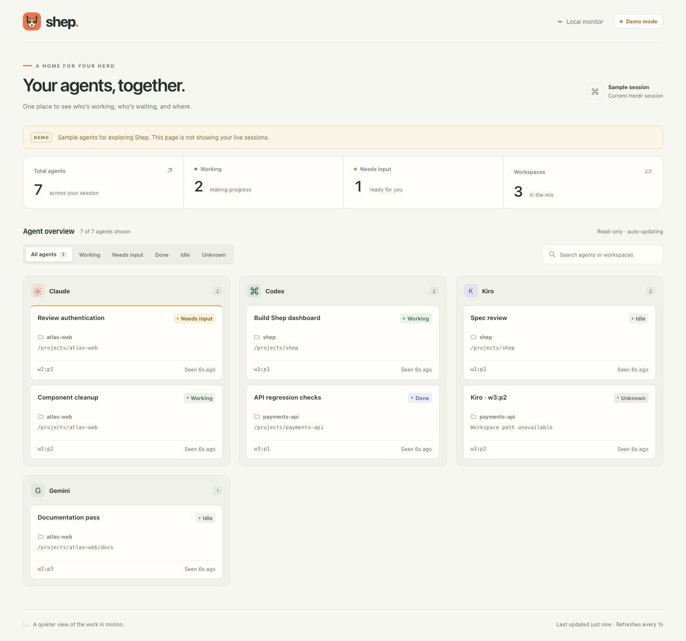
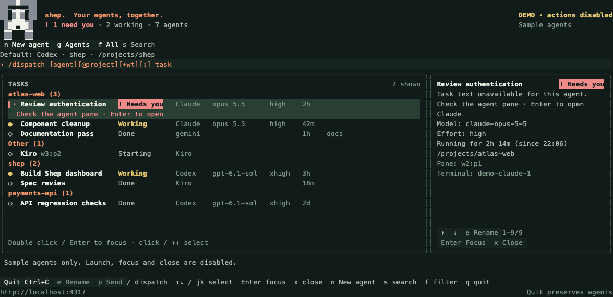

<p align="center">
  
</p>

<h1 align="center">Shep</h1>
<p align="center"><strong>Your agents, together.</strong></p>

Shep is an [Ink](https://github.com/vadimdemedes/ink) terminal interface for dispatching and managing coding agents inside [Herdr](https://herdr.dev/). Run `shep`, then type `/dispatch claude@folio: add unit tests` to choose an agent, project and task. Follow tasks by project or agents by provider, see who needs input, and focus or close agent panes from the same interface.

This branch provides **0.4.0-checkpoint.1**, a local, unpublished preview of project-aware dispatch. Fan-out, templates, named profiles, persisted task history, follow-ups from Shep, worktree cleanup controls and additional shell subcommands are deferred.

Keep it beside your chat in a terminal pane, or open its browser companion at **http://localhost:4317**. Both views show agent metadata from your current Herdr instance; the task board stays private to the terminal interface.

For the full daily workflow, read the [Shep operating procedure](docs/SOP.md): dispatch, monitoring, follow-ups, closing agents, recovery, and updates.



*Preview uses clearly labeled sample agents. Shep reads live status from Herdr when you run it normally.*

## What Shep does

- Dispatches a literal prompt into its own Herdr tab, reusing the project's workspace or creating one.
- Uses a separate Git worktree when another agent is working in that checkout, with a visible placement preview and notice.
- Offers a project picker, command suggestions and command recall for the current run.
- Groups tasks by project, shows Git change summaries and sends Herdr notifications when a task finishes or needs input.
- Groups agents by provider, including Claude, Codex, Grok, Kiro, and additional types reported by Herdr.
- Lets you select agents with arrow keys or a mouse, focus their real panes, and confirm closing them.
- Shows which agents are working, waiting for input, done, idle, or unknown.
- Displays each agent's workspace and working directory across the current Herdr session.
- Supports search and keyboard navigation in the terminal, plus search and status filters in the browser companion.
- Brings a small pixel-art shepherd dog to the terminal header, with a compact mark in narrow panes.
- Refreshes about every two seconds and marks retained data as stale if the connection drops.
- Runs locally without a model account or cloud service of its own. Each agent uses its existing installation and authentication.

Shep is a coordinator, not another AI model. It sends the prompt you write to the tool you select, while Herdr owns the agent process and status. It does not automatically approve trust dialogs or questions, rewrite prompts, or replay an uncertain submission. The browser companion stays read-only.

## Requirements

| Requirement | Details |
| --- | --- |
| Herdr | Version 0.9.1 or newer, with a running session |
| Node.js | Version 22.23.2 or newer, with `node` and `npm` on your PATH |
| Operating system | macOS or Linux |
| Git | Needed for repository discovery, change summaries and worktree isolation |

Automated checks cover Node.js 22.23.2 and 26.7.0 on macOS; native integration targets Herdr 0.9.1. Linux has not been verified.

**Run Shep inside a Herdr pane.** It can start from any folder in that pane. A regular terminal outside Herdr cannot start the dashboard; `shep --help` and `shep --version` work anywhere.

## Installation

### 1. Get the source

```sh
git clone https://github.com/andrizzit/shep.git
cd shep
```

The public default branch may still be 0.3.0 while this preview is unpushed. To build the checkpoint, use its reviewed `feat/smart-dispatch` checkout or the supplied checkpoint tarball; do not expect a fresh clone to contain local work.

### 2. Build and install the local package

```sh
npm ci --ignore-scripts
npm pack
npm install --global --prefix "$HOME/.local" ./shep-herdr-plugin-0.4.0-checkpoint.1.tgz --offline --ignore-scripts --no-audit --no-fund
```

This installs the `shep` and `shep-run` commands into `$HOME/.local/bin`, and copies the app and browser assets into `$HOME/.local/lib/node_modules/shep-herdr-plugin`. The package's internal name is `shep-herdr-plugin`; the app and command are **Shep** and **`shep`**.

`npm ci` downloads the locked Ink/React dependencies when building from source. `npm pack` bundles the runtime dependencies, so installing the resulting tarball works offline. The installed app is a copy: it does not depend on the source checkout remaining in its original location. No npm registry release is published; use the package built from this repository.

### 3. Make the commands available

If `$HOME/.local/bin` is not already on your PATH, run:

```sh
export PATH="$HOME/.local/bin:$PATH"
```

Add that same line to your shell configuration to keep it for future terminals: `~/.zshrc` for zsh or `~/.bashrc` for bash. Verify the installation:

```sh
shep --version
```

## Run, close, and reopen

In any Herdr pane, from any folder:

```sh
shep
```

`shep-run` is an equivalent command. Shep stays in the pane where you launch it, so run it in the pane on the right of your chat for a side-by-side view. It automatically connects to **that pane's current Herdr instance** and shows agents across all its workspaces.

Type a command in Shep and press **Enter**:

```text
/dispatch claude@folio: add unit tests for the ledger
/dispatch codex@shep: fix the settings page
/dispatch review the current changes
```

The `provider:` and `@project` parts are optional. `/dispatch your task` always uses **Codex** in the context project; `/dispatch claude: your task` keeps working. Use `/dispatch claude@folio/src/api: your task` to request a project subfolder. Unknown or unavailable providers and ambiguous projects produce an error before launch. **Tab** accepts a suggestion; **Enter** submits the command. Up/Down recalls commands from this run.

Press **n** for the composer: provider, project or **Other folder…**, subfolder, optional name and multiline prompt. Use **Tab** to move between fields. Review the proposed location before dispatch. Herdr starts a worktree at its repository root; when a requested subfolder cannot apply, Shep shows that notice before launch.

Use `/dispatch codex@shep+here: your task` to keep a task in the main checkout even when another agent is working there. You are choosing to share that checkout, so coordinate edits. Task details show an automatically created worktree's path and its manual removal command, `herdr worktree remove --workspace <id>`. Review and preserve its changes before removing it. The **W** cleanup action is the first planned post-checkpoint item; `+wt`, fan-out, named profiles and templates remain deferred.

**Known sign-in limitation:** if an agent needs sign-in, Shep may submit the task into that screen, as 0.3.0 does. Herdr's readiness signal does not guarantee that authentication is complete. Sign in before dispatching; if setup appears, inspect the created pane before sending anything again. Shep does not add authentication handling or screen parsing.

Press **g** to switch between Tasks grouped by project and Agents grouped by provider. Tasks and drafts last only for this run. After restarting, still-running agents appear in the Agents view.

Use **↑/↓** to select an agent and **Enter** to focus its actual Herdr pane. Mouse clicks select agents; the Focus and Close buttons act on that selection. **x** opens a close confirmation. Closing an agent ends that pane’s process; it is separate from quitting Shep, which leaves all agents running.

While Shep is running, open [localhost:4317](http://localhost:4317) for the read-only browser dashboard. Quitting Shep also stops that browser server.

- **Close:** press `q` outside editors, or press `Ctrl+C` at any time.
- **Reopen:** run `shep` again in the pane.
- **Agents:** continue running when Shep closes.

### Enable project discovery

Open `~/.config/shep/config.json` (or `$XDG_CONFIG_HOME/shep/config.json`) and add a projects section. For example, this is a complete one-line config for projects in `~/Documents/DevLearning/GitProjects`:

```json
{"projects":{"roots":["~/Documents/DevLearning/GitProjects"]}}
```

If the file already contains settings, merge this section into it instead of replacing the file. Restart Shep or reload configuration from the composer. Discovery roots default to empty. Open workspaces also contribute projects; the picker offers **Other folder…** for an existing folder outside your registered projects. Configured roots are scanned with bounds, not recursively without limit.

Shep only persists a configuration change when you explicitly confirm trust for an exact repository. It grants no blanket repository trust and adds no handling for agent trust dialogs. To turn off notifications, add `"notifications":{"enabled":false}` to your config; `"sound":false` keeps them silent. Notifications cover Shep tasks by default and suppress alerts for an agent you are already viewing.



*Terminal preview rendered by the actual Ink components with sample data. Colors and glyph appearance depend on your terminal.*

### Command options

| Command | Behavior |
| --- | --- |
| `shep` | Interactive Ink orchestrator and read-only browser companion |
| `shep-run` | Alias for `shep` |
| `shep --web` | Browser companion only; keep this process running in Herdr |
| `shep --port 4319` | Use a different localhost port |
| `shep --demo --port 4318` | Show sample agents with dispatch/focus/close disabled |
| `shep --help` | Show command help |
| `shep --version` | Show the installed version |

`SHEP_PORT` sets the default port; `--port` overrides it. `NO_COLOR=1 shep` disables terminal colors. `--terminal` explicitly selects the default terminal view. Redirected/noninteractive output uses a plain read-only board; orchestration requires an interactive terminal.

### Terminal controls

| Key | Action |
| --- | --- |
| `↑` / `↓` or `k` / `j` | Select an agent |
| `Enter` | Focus the selected agent’s actual Herdr pane |
| `/` | Enter `/dispatch [provider][@project]: your task`; press Enter to launch |
| `g` | Switch Tasks / Agents |
| `d` / `→` | Open selected task or agent details; use Up/Down to scroll |
| `i` | Read the full notice, including long diagnostic paths |
| `n` | Open optional launch settings and multiline composer |
| `Tab` / `Shift+Tab` | Move between composer fields |
| `←` / `→` | Change the selected composer option |
| `Ctrl+S` | Submit the composer |
| `s` | Search agents and workspaces |
| `f` | Cycle status filters |
| `x` | Confirm closing the selected agent |
| `Esc` | Cancel or leave the current editor/dialog |
| `r` | Refresh the overview |
| `Ctrl+R` | Reload configuration, providers and projects |
| `q` | Quit outside editors |
| `Ctrl+C` | Quit Shep; leave agents running |

Pasted multiline prompts remain prompt text rather than keyboard shortcuts. Mouse support uses the terminal’s SGR mouse protocol; keyboard controls are always available. When focus moves to an agent, use Herdr’s pane navigation to return to Shep.

## What the statuses mean

| Status | Terminal color | Meaning |
| --- | --- | --- |
| Working | Yellow | Herdr reports active work |
| Needs input | Red | Herdr reports `blocked`, such as an input or permission prompt |
| Done | Teal | Herdr reports completion not yet marked seen |
| Idle | Green | Herdr reports an idle agent |
| Unknown | Gray | Herdr cannot determine the status, or returns an unfamiliar value |

Status accuracy follows Herdr's detectors. Reading the overview does not mark completed work as seen. Explicitly focusing an agent through Herdr marks it seen, so Done can become Idle. If Herdr becomes unavailable after a successful connection, the last snapshot stays visible with a stale warning. A successful empty snapshot clears agents that are no longer present.

The scope is **one current Herdr instance**. Agents in other instances, other terminal applications, remote machines, or internal subagents that Herdr does not expose are not shown. Startup requires the host-provided socket and pane context; there is no manual session selector. `--session` is rejected and `SHEP_SESSION` is ignored.

## Optional Herdr plugin shortcut

You can also register the installed app as a Herdr plugin that opens a new split pane:

```sh
herdr plugin link "$HOME/.local/lib/node_modules/shep-herdr-plugin"
herdr plugin pane open --plugin shep --entrypoint board --direction right --no-focus
```

The new pane is labeled **🐕 Shep**. The plugin and the `shep` command use the same application. Stop an existing Shep instance first, or give the new one another port:

```sh
herdr plugin pane open --plugin shep --entrypoint board --direction right --no-focus --env SHEP_PORT=4319
```

The plugin shortcut is optional. Typing `shep` in an existing pane is enough to use the app.

## Troubleshooting

| Problem | What to do |
| --- | --- |
| `shep: command not found` | Check that `$HOME/.local/bin` is on PATH. Try `$HOME/.local/bin/shep --version`, then open a fresh shell if needed. |
| “Shep runs only inside Herdr” | Open a shell pane inside Herdr and run `shep` there. A regular terminal is not enough, even if Herdr is running elsewhere. |
| Current pane/session is unavailable | Quit and reopen Shep from a current Herdr pane. It checks the pane, tab, workspace, and socket supplied by the host before starting. |
| Port 4317 is already in use | Stop the other Shep instance or run `shep --port 4319`; then visit localhost:4319. |
| No agents found | Start a supported agent inside the same Herdr instance. Empty provider groups are expected until matching agents exist. |
| Connection interrupted / stale data | Check that Herdr is running, then press `r` or use the browser's Retry button. Polling retries automatically. |
| Browser stops responding after quitting | The browser server belongs to the Shep process. Run `shep` again to reopen it. |

## Dispatch and close behavior

Agent availability means the command is installed, not that it is authenticated or ready. Shep starts tools through Herdr’s supported agent interface. If startup or prompt delivery times out, the created pane is preserved and the result explains what is known; Shep never retries a prompt automatically. Focus the pane to inspect a login, trust prompt, question, or uncertain submission before sending anything again.

Controls are disabled when the view is stale/disconnected or showing demo data. Every mutation also refreshes the current session and target identity. Closing requires confirmation and rejects a changed target/status, including an agent that started working after you opened the dialog. Shep protects its own pane. Herdr 0.9.1 does not provide an atomic identity-conditional close, so a small interval remains between the final identity check and the close request.

## Local data and privacy

Shep reads agent identity, status, pane/workspace metadata, and working directories through `herdr api snapshot`, and uses local Git metadata for project discovery, placement and change summaries. Task records, command recall and drafts stay in memory; this checkpoint does not create or read a history file. Repository trust confirmations are saved in Shep's local config. Shep does not collect credentials or transmit data to a hosted service of its own. On dispatch, your selected agent receives the prompt and applies its own data and provider settings.

The read-only `/api/snapshot` endpoint publishes ordinary Herdr metadata, which may include task-derived agent names, tab/workspace labels and paths. It never includes task records, prompts, expanded templates, history, launch arguments or config. Names and labels summarize tasks, so avoid putting secrets into task titles. Native Herdr and agent tools retain their own data according to their settings.

The browser server binds to `127.0.0.1` and serves only the dashboard assets and the snapshot endpoint. Other local processes and users with access to your machine may be able to read this dashboard. Host/Origin checks restrict browser requests; the Herdr environment check is host integration, not authentication against deliberately forged environment variables.

## Update or uninstall

To update, stop Shep, pull the latest source, then repeat the package/install commands from the installation section. Reopen it with `shep`. Source edits do not change an already installed copy. If the plugin manifest changed, repeat the optional `herdr plugin link` command.

To uninstall, first stop Shep. If you registered the optional plugin, remove its registration:

```sh
herdr plugin unlink shep
```

Then remove the installed commands and application:

```sh
npm uninstall --global --prefix "$HOME/.local" shep-herdr-plugin
```

Your agents, Herdr sessions, and source checkout remain intact.

## Development

Install the locked development/runtime dependencies, then run the checks. There is no transpilation build step:

```sh
npm ci --ignore-scripts
npm run check
npm test
```

The tests use Node's built-in test runner, controlled Herdr fixtures, temporary localhost servers, and Python 3 for installed-package terminal checks. They cover literal prompt delivery, provider routing, keyboard/mouse controls, close confirmation, current-instance validation, uncertain outcomes, shutdown, package installation, stale recovery, and HTTP boundaries. Tests do not need a running Herdr session.

To run from source inside Herdr:

```sh
npm start         # Ink orchestrator and browser companion
npm run demo     # Browser demo at localhost:4318
```

Optional browser checks need a separately installed Playwright with Chromium. An axe module enables the accessibility scan:

```sh
SHEP_PLAYWRIGHT_MODULE=/absolute/path/to/playwright/index.mjs \
SHEP_AXE_MODULE=/absolute/path/to/@axe-core/playwright/dist/index.mjs \
node scripts/verify-ui.mjs
```

The browser runner starts and stops its own controlled test server. Set `SHEP_LIVE_URL=http://localhost:4317` to check an already-running live app instead. `scripts/preview-terminal.mjs` renders the sample terminal preview using the same optional Playwright setup. Browser tooling is not included in the installed app.

| Location | Purpose |
| --- | --- |
| `bin/` | Installed command entrypoint |
| `src/` | Ink components, native agent controls, CLI, polling, plain terminal fallback, and HTTP server |
| `public/` | Browser dashboard and shepherd-dog icon |
| `tests/` | Automated tests and controlled sample fixtures |
| `scripts/` | Syntax and optional visual checks |
| `docs/images/` | Sample dashboard previews |
| `herdr-plugin.toml` | Optional Herdr plugin entrypoint |

## Herdr integration references

- [Plugin interface](https://herdr.dev/docs/plugins/)
- [Socket API](https://herdr.dev/docs/socket-api/)
- [Agent detection](https://herdr.dev/docs/agents/)
- [CLI reference](https://herdr.dev/docs/cli-reference/)

## License

Shep is available under the [MIT License](LICENSE). You can use, modify, and redistribute it, including commercially, under that license's terms.
